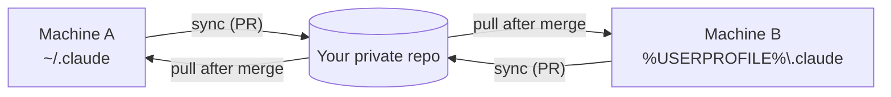

<div align="center">

# claude-config-sync

**Keep Claude Code's settings, skills, agents, hooks and memory the same on every machine.**


[](https://claude.com/claude-code)

[Prerequisites](#prerequisites) • [Quick start](#quick-start) • [Remote sessions](#claude-code-on-the-web-remote-sessions) • [Make it work](#make-it-work) • [Commands](#commands) • [What syncs](#what-syncs) • [Per-machine tweaks](#per-machine-tweaks) • [Troubleshooting](#troubleshooting)

</div>

---

## What is this?

Claude Code keeps your personal setup in `~/.claude/` (instructions, settings, agents, hooks) and `~/.agents/` (skills). Use Claude on a laptop, a desktop and a server and you end up with three slightly different setups.

This tool fixes that. A **private GitHub repo** holds the one true copy. A small Python program copies changes between that repo and each machine, and every change goes out as a **pull request** you review and merge. Nothing is ever pushed straight to your default branch.



## Features

- **Linux and Windows, with macOS expected to work.** Same commands everywhere (`.sh` shims on Linux and macOS, `.cmd` shims on Windows). CI runs on Linux and Windows only.
- **Pull-request based.** Each machine gets its own `sync/<hostname>` branch and PR. You merge; other machines pick it up on their next sync.
- **Automatic.** Hooks run a sync at the start and end of every Claude Code session.
- **Safe by default.** The first-time bootstrap deletes nothing local-only, credentials are never synced, and every failure says what went wrong and what to do.
- **Claude Code on the web.** `claude-sync.sh remote` in the environment's setup script gives remote sessions your config. See [Remote sessions](#claude-code-on-the-web-remote-sessions).
- **Per-machine tweaks.** Overrides for `settings.json` and profiles for agents, hooks, skills and `CLAUDE.md`, so one box can differ without forking everything.
- **Self-diagnosing.** `doctor` finds a stuck sync and `doctor remediate` fixes what is safe to fix.
- **No dependencies.** Python standard library only.

## Prerequisites

You need three things on **every** machine: Python 3.12 or newer, git 2.40 or newer, and the GitHub CLI (`gh`) logged in. On Windows you also need Git Bash.

| Tool | Why | Check it |
|---|---|---|
| **Python** 3.12+ | Runs the tool itself. Standard library only. | `python3 --version` (Windows: `py -3 --version`) |
| **git** 2.40+ | Holds your config. | `git --version` |
| **GitHub CLI** (`gh`) | Opens each machine's pull request. | `gh auth status` |
| **Git Bash** (Windows only) | Session hooks run `claude-sync.sh`. It comes with Git for Windows. | `python3 --version` inside Git Bash |
| **Node.js / npm** (optional) | Only for the `ccusage` helper the installer adds. | `npm --version` |

Without `gh` nothing is pushed: before each push, sync asks GitHub whether the repo `origin` pushes to (its push URL) is private and not a template, and refuses (nothing pushed) if it is public, a template, or cannot be checked. Point `origin` at a private, non-template repo.

### Install them

<details open>
<summary><b>Linux</b></summary>

Ubuntu 24.04 and newer already ship a recent enough Python and git. Pick your distro:

```bash
# Debian / Ubuntu
sudo apt update && sudo apt install -y git python3 gh

# Fedora / RHEL
sudo dnf install -y git python3 gh

# Arch
sudo pacman -S --needed git python github-cli
```

Older distros ship an older Python (Debian 12 has 3.11, Ubuntu 22.04 has 3.10). Install Python 3.12 or newer from your distro's backports or another source before you continue, or every sync will fail.

If `gh` is not in your distro's repositories, use the [official install steps](https://github.com/cli/cli/blob/trunk/docs/install_linux.md). Then log in:

```bash
gh auth login
```

Pick **HTTPS** or **SSH** when asked. With HTTPS, answer **Yes** to "Authenticate Git with your GitHub credentials" so `git` can clone and push with no SSH key. With SSH, `gh` can create and upload a key for you.

Optional, for `ccusage`: `sudo apt install -y nodejs npm` (or your distro's equivalent).

</details>

<details open>
<summary><b>Windows</b></summary>

In PowerShell or Command Prompt, using the built-in `winget`:

```bat
winget install --id Git.Git -e                    # git + Git Bash
winget install --id Python.Python.3.12 -e         # Python + the py launcher
winget install --id GitHub.cli -e                 # gh
winget install --id OpenJS.NodeJS.LTS -e          # optional, for ccusage
```

**Close and reopen your terminal**, then log in to GitHub:

```bat
gh auth login
```

When asked, pick **HTTPS** (the easiest on Windows) and answer **Yes** to "Authenticate Git with your GitHub credentials". That lets `git` clone and push with no SSH key. If you would rather use SSH, you also need the OpenSSH client (Settings, System, Optional features, "OpenSSH Client") and an SSH key added to GitHub. The error `cannot spawn ...\ssh.exe` means the client is missing.

Then check that **Git Bash** can run Python, because the session hooks run there. Open Git Bash and run:

```bash
python3 --version
```

It must print 3.12 or newer. If it opens the Microsoft Store, prints nothing or says "not found", Git Bash has no real `python3` (the Windows Store stub does not count). A common fix is to copy `python.exe` to `python3.exe` in your Python install folder. See "Checks for each machine" in [`docs/runbook.md`](docs/runbook.md).

You do not need Git Bash just to run the `.cmd` shims by hand. They only need `py` or `python`.

</details>

<details>
<summary><b>macOS</b></summary>

Stock macOS ships Python 3.9, which is too old. With [Homebrew](https://brew.sh):

```bash
brew install git python gh
gh auth login
```

</details>

> [!NOTE]
> macOS is expected to work but is not covered by the project's CI.

## Quick start

### Option A: one command

Run one command and it installs what is missing (git, Python 3.12+, `gh`), logs you in to GitHub, clones **your** private repo and runs the installer. First make your private repo from the template (`gh repo create YOUR_REPO --private --template modem7/claude-config-sync`, or **Use this template** in the browser; see Option B, step 1). Then replace `YOUR_USER/YOUR_REPO` below with its name.

**Linux / macOS**

```bash
curl -fsSL https://raw.githubusercontent.com/modem7/claude-config-sync/main/get.sh | bash -s -- YOUR_USER/YOUR_REPO
```

**Windows PowerShell**

`irm ... | iex` cannot take parameters, so pass the repo in an environment variable:

```powershell
$env:CLAUDE_SYNC_REPO = 'YOUR_USER/YOUR_REPO'; irm https://raw.githubusercontent.com/modem7/claude-config-sync/main/get.ps1 | iex
```

To pass flags (here `-Yes`), run it as a script block instead:

```powershell
& ([scriptblock]::Create((irm https://raw.githubusercontent.com/modem7/claude-config-sync/main/get.ps1))) -Repo YOUR_USER/YOUR_REPO -Yes
```

**Windows Command Prompt (cmd.exe)**

```bat
set "CLAUDE_SYNC_REPO=YOUR_USER/YOUR_REPO"
powershell -NoProfile -ExecutionPolicy Bypass -Command "irm https://raw.githubusercontent.com/modem7/claude-config-sync/main/get.ps1 | iex"
```

> [!WARNING]
> `get.ps1` has been run only under PowerShell 7 on Linux with stand-in programs. It has **not** been tried on Windows, on Windows PowerShell 5.1, with real `winget`, or from a real `cmd.exe`. Try `-DryRun` first, and use Option B if anything looks wrong.

Piping a script from the internet into a shell runs it before you have read it. If you would rather read it first, download it, look at it, then run it:

```bash
curl -fsSL https://raw.githubusercontent.com/modem7/claude-config-sync/main/get.sh -o get.sh
less get.sh
bash get.sh YOUR_USER/YOUR_REPO
```

```powershell
irm https://raw.githubusercontent.com/modem7/claude-config-sync/main/get.ps1 -OutFile get.ps1
notepad get.ps1
powershell -NoProfile -ExecutionPolicy Bypass -File .\get.ps1 -Repo YOUR_USER/YOUR_REPO
```

The scripts print a `[n/6]` line per step, ask before installing anything, and refuse to go on if Python is older than 3.12, if a Python virtualenv is active (Windows), if the clone folder exists but is not a git clone, or if it has no `origin` remote. An existing clone is used as it is. A repo name is only accepted as `OWNER/REPO`, not a URL.

| Linux / macOS | PowerShell | What it does |
|---|---|---|
| `OWNER/REPO` (first argument) | `-Repo OWNER/REPO` | Your private sync repo. Else `CLAUDE_SYNC_REPO`, else a prompt. |
| `--dir PATH` | `-Dir PATH` | Where to clone it. Else `CLAUDE_SYNC_DIR`, else `~/claude-config`. |
| `--project-path PATH` | `-ProjectPath PATH` | Passed to the installer: your main Claude Code project folder. |
| `--profile NAME` | `-Profile NAME` | Passed to the installer: follow `machines/NAME/`. |
| `--tier basic\|full` | `-Tier basic\|full` | Passed to the installer: what a new machine syncs (default `full`). `basic` skips memory, the pip packages and `ccusage`; only `gh` is set up. |
| `--skip-python-deps` | `-SkipPythonDeps` | Passed to the installer: skip the agent-memory plugin's pip packages. Only matters on the `full` tier, since `basic` already skips them. |
| `--yes` | `-Yes` | Accept every default answer in the script. |
| `--dry-run` | `-DryRun` | Print the commands that change things instead of running them. |

`--yes` does **not** answer the installer's own project-path question. For a hands-off run, also pass `--project-path` (`-ProjectPath`). The `CLAUDE_SYNC_REPO` and `CLAUDE_SYNC_DIR` environment variables are the only way to give settings through `irm | iex`.

### Option B: step by step

Use this if you would rather run each step yourself, or Option A does not work on your machine.

<details>
<summary><b>Show the manual steps</b></summary>

### 1. Make your own private repo

This tool syncs *your* personal config, so it needs *your* repo. Do not point it at this one.

This repo is a **template**, so your copy starts with a clean history and stays private.

- **In the browser:** click **Use this template**, then **Create a new repository**, and choose **Private**.
- **From the command line** (needs `gh`, see [Prerequisites](#prerequisites)):

  ```bash
  gh repo create YOUR_REPO --private --template modem7/claude-config-sync
  ```

Do not **fork** it: GitHub keeps a fork of a public repo public, and this tool syncs your personal config.

### 2. Install on your first machine

Log in to `gh` first (see [Prerequisites](#prerequisites)). `gh repo clone` uses whichever of HTTPS or SSH you chose there. The tool reads your repo's URL from the clone's `origin`, so the commands below pass it on for you.

<details open>
<summary><b>Linux / macOS</b></summary>

```bash
gh repo clone YOUR_USER/YOUR_REPO ~/claude-config
CLAUDE_SYNC_REPO_URL=$(git -C ~/claude-config remote get-url origin) ~/claude-config/install.sh
```

</details>

<details open>
<summary><b>Windows</b></summary>

> [!TIP]
> Not sure which Windows terminal you are in? A **PowerShell** prompt starts with `PS C:\...>`. A **Command Prompt** (cmd.exe) prompt is just `C:\...>`. The two use different syntax, so copy the matching block.

Everything after `--` goes to git. `core.autocrlf=false` keeps line endings exactly as they are.

**PowerShell**

```powershell
gh repo clone YOUR_USER/YOUR_REPO "$HOME\claude-config" -- -c core.autocrlf=false
$env:CLAUDE_SYNC_REPO_URL = git -C "$HOME\claude-config" remote get-url origin
& "$HOME\claude-config\install.cmd"
```

**Command Prompt (cmd.exe)**

```bat
gh repo clone YOUR_USER/YOUR_REPO "%USERPROFILE%\claude-config" -- -c core.autocrlf=false
for /f "delims=" %i in ('git -C "%USERPROFILE%\claude-config" remote get-url origin') do set CLAUDE_SYNC_REPO_URL=%i
"%USERPROFILE%\claude-config\install.cmd"
```

</details>

The installer asks one question: the **primary folder you run `claude` from** on this machine (default `~/project`). It uses that to find Claude Code's memory folder. Skip the prompt with `--project-path /absolute/path`, or with `--tier basic`, which does not sync memory.

Then it runs a one-time **bootstrap**: it adopts what is already in your repo, then contributes anything unique to this machine. Nothing local gets deleted and nothing shared gets overwritten.

### 3. Merge the pull request

The bootstrap opens a PR from `sync/<hostname>`. Review it, merge it, and your repo now holds your setup.

### 4. Add the next machine

Run the same install steps on the next machine (same repo URL). It adopts your merged config. After that, everything is automatic.

> [!NOTE]
> Run the installer with your **system** Python, not from a virtualenv or `uv run`. Its pip step installs into whichever Python runs it.

</details>

## Claude Code on the web (remote sessions)

Claude Code on the web (and any other cloud session) starts in a fresh container with an empty `~/.claude`. Do **not** run the installer there: it would push a new `sync/<hostname>` branch for every container. Use `claude-sync.sh remote` instead. It applies the config from the sync repo the platform already checked out, and never fetches, pushes, opens a PR, or needs `gh`.

### Set it up

Open the **Edit environment** screen: on claude.ai/code, or in the Claude app, open the environment menu in a session's title bar, then **Edit**. For a private sync repo you need an environment with a **Repositories** list (the Default one has none; see step 2 below). The fields, top to bottom:

| Field | What to do for this tool |
|---|---|
| **Name** | Name it after your sync repo. |
| **Network access** | Leave it on **Full**. `--plugins` and `--tools` download from GitHub and package registries; with a limited level, allow those hosts or the installs fail. |
| **Setup script** | Paste the script below. It is a bash script that runs once when a new session starts, before Claude Code launches. **Choose file** loads a script from a file instead of pasting; pasting is easier on a phone. |
| **Environment variables** | Optional. Only for a named cloud machine (see "Give the cloud machine its own config"). The setup script cannot read these, so it never relies on them. |

Paste this into **Setup script**. Change `OWNER/REPO` on the `SYNC_REPO` line to your sync repo:

```bash
#!/bin/bash
# Apply the synced Claude config in this fresh container. The sync repo is the
# checkout that has a machines/ folder. If the session did not include it, try to
# clone it (this only works for a public repo). Always exits 0 so a problem never
# blocks the session, but every problem prints a WARNING line.
SYNC_REPO="OWNER/REPO"
find_sync() {
  for d in */; do
    if [ -f "${d}claude-sync.sh" ] && [ -d "${d}machines" ]; then
      echo "${d%/}"
      return 0
    fi
  done
  return 1
}

dir=$(find_sync) || true
if [ -z "$dir" ]; then
  echo "No sync repo checkout in $(pwd); cloning ${SYNC_REPO}" >&2
  if timeout 120 git clone --depth 50 "https://github.com/${SYNC_REPO}.git" sync-repo >&2; then
    dir=sync-repo
  else
    echo "WARNING: could not clone ${SYNC_REPO} (a private repo cannot be cloned here)." >&2
    echo "WARNING: agents, skills and CLAUDE.md were NOT applied." >&2
    echo "WARNING: list the repo under Repositories in the environment settings." >&2
  fi
fi

if [ -n "$dir" ]; then
  (cd "$dir" && CLAUDE_SYNC_REMOTE=1 CLAUDE_SYNC_HOSTNAME=cloud \
    timeout 600 ./claude-sync.sh remote --plugins --tools) \
    || echo "WARNING: claude-sync remote failed in ${dir}: config NOT applied" >&2
fi
exit 0
```

Then:

1. Check the script still starts with `#!/bin/bash`, and tap **Save changes**.
2. **Get the sync repo into every session.** The setup script runs in the folder that holds the session's checkouts. It cannot read your saved secrets, so it cannot clone a private repo itself.
   - **Private sync repo (the normal case):** if the environment has a **Repositories** list, add the sync repo there. The platform then checks it out in every session on that environment, even one started with no repo ticked, so there is nothing to select each time. The new-session repo picker takes more than one repo, so you can still tick the sync repo yourself next to the project you are working on. Without the list or a ticked repo the config is not applied, and the script only prints a `WARNING` line. The Default environment has no such list, so make a new environment for this.
   - **Public sync repo (for example a fork of the public template):** nothing more is needed. The script clones it when the session did not include it. Listing it under Repositories is still the more reliable route; the clone is a backstop.
3. In the new session, check that `~/.claude/CLAUDE.md` and `~/.claude/agents/` are there (run `ls ~/.claude`, or ask Claude to). If they are missing, run `ls -d */` to see whether the sync repo was checked out.
4. Sessions that were already running keep the old script; only new ones run the saved one. If you change the script later, save it and start another new session to try it.

The script is safe to paste as it is: it finds the sync repo by its `machines/` folder, always exits 0 so it cannot stop a session from starting, prints a `WARNING` line for each thing that goes wrong (clone failed, `remote` failed), gives the installs ten minutes (`timeout 600`) so a hung download cannot hold the session up, and applies the config before it installs anything. `remote` takes only `--plugins` and `--tools`; any other word prints its usage, and the script's `exit 0` hides that failure unless you read the `WARNING` line. `CLAUDE_SYNC_REMOTE=1` is what tells `remote` it is in a cloud session; `remote` refuses to run without it on a machine you own, where it would replace your config with the `cloud` machine's.

**Agents in cloud sessions.** On some plans a new session may not start subagents unless asked. The synced `CLAUDE.md` has a standing request that tells Claude to use your defined agents without asking. Its effect on that default is untested, but it worked in trial sessions, so check that file is in place (step 3) if an agent such as `script-writer` is not used.

### How it fits together

- `remote` runs as a machine called `cloud`, on the `basic` tier (everything except memory, which is keyed to a project path that differs per container). It writes `machines/cloud.conf` with `TIER=basic` when the repo has none, without committing it, and needs no git identity. It applies the checkout as it was cloned, normally the default branch when the session started, so a change merged in a PR shows up in the next new session.
- It is **one-way**. Edits made inside a remote session are not captured. Change shared config on a machine you own, or in a PR on the sync repo.
- **Opt-in installs.** `--plugins` runs `doctor install-plugins --yes` after the apply: the `claude plugin marketplace add` and `claude plugin install` commands for what `settings.json` enables and the container lacks. Each fetches third-party code from the source named, which is why it is off unless you pass it. With `PLUGINS=full` in `machines/<hostname>.conf` (or `claude-sync.sh machine NAME plugins full`), `sync`, `pull` and `remote` run the same install with `--yes` after every apply, quietly when nothing is missing, so every plugin `settings.json` enables is installed without a command. It installs nothing else, a failure only prints a warning (the config is already applied), and the default is `off`. Because the list comes from a synced file, turn it on only for machines whose config repo you trust. `--tools` installs `gh` (if missing) and `ccusage`; the Python packages for the agent-memory plugin are not part of it. A failed `--plugins` step leaves the applied config in place and fails the run; `--tools` problems only print a warning.
- **Not carried over:** credentials and MCP server logins.
- **A cloud session is told apart from a machine you own** by Claude Code's `CLAUDE_CODE_REMOTE=true` (or `CLAUDE_SYNC_REMOTE=1`; `CLAUDE_SYNC_REMOTE=0` turns it off). There, `sync` and `pull` run as `remote`, and `push`, `bootstrap`, `override`, `profile`, `tier`, `machine` (except `machine NAME show`) and the installer are refused, so nothing is ever pushed. That makes the synced session hooks safe in a container too, and one `settings.json` work everywhere. The script names `remote` itself because that variable may not be set while it runs.

### Give the cloud machine its own config

The cloud machine is a machine like any other: `machines/cloud.conf` holds its tier, profile and (optionally) `PLUGINS=full`, and `machines/cloud.settings.json` is its settings override, which is also how its plugins are chosen. Edit them from any machine you own with `machine`, which goes through your usual sync PR:

```bash
claude-sync.sh machine cloud show                                   # tier, profile, overrides
claude-sync.sh machine cloud plugin disable heavy-plugin@some-market # not on this machine
claude-sync.sh machine cloud plugin enable  extra@some-market        # only on this machine
claude-sync.sh machine cloud plugin inherit heavy-plugin@some-market # follow the shared setting again
claude-sync.sh machine cloud override set .model '"haiku"'          # any other settings key
claude-sync.sh machine cloud plugins full                           # install every enabled plugin on each session
claude-sync.sh machine cloud tier full /absolute/path               # opt in to memory (see Sync tiers)
claude-sync.sh machine cloud profile use my-profile                 # follow machines/my-profile/
```

Each change waits for its PR to be merged. Repeating a change changes nothing, and `show` never changes anything. A name that is neither `cloud`/`cloud-...`, an existing machine nor an existing profile is refused as a likely typo. If the machine follows a profile that other machines share, `plugin` and `override` refuse and name it, because the change would reach all of them: run `machine PROFILE ...` to change the profile on purpose, or `machine NAME profile use NAME` to give the machine its own. For a separate config per environment (say one for a Rust project), give each environment its own name: put `CLAUDE_SYNC_HOSTNAME=cloud-rust` in the script line and in the environment's **Environment variables**, then run `machine cloud-rust ...`. The name in the script line is the one that counts while the script runs; the environment variable is what the session's hooks see.

## Make it work

A walk-through to check everything is wired up, with the same steps on both platforms.

<details>
<summary><b>Linux / macOS</b></summary>

```bash
# 1. Prerequisites are present?
python3 --version && git --version && gh auth status

# 2. Is the sync healthy? (read-only report)
~/claude-config/claude-sync.sh doctor

# 3. Run a sync by hand and watch what it does
~/claude-config/claude-sync.sh sync

# 4. Did the session hooks log anything?
tail ~/.claude/claude-config-sync.log
```

</details>

<details>
<summary><b>Windows</b></summary>

**PowerShell**

```powershell
# 1. Prerequisites are present?
py -3 --version; git --version; gh auth status

# 2. Is the sync healthy? (read-only report)
& "$HOME\claude-config\claude-sync.cmd" doctor

# 3. Run a sync by hand and watch what it does
& "$HOME\claude-config\claude-sync.cmd" sync

# 4. Did the session hooks log anything?
Get-Content "$HOME\.claude\claude-config-sync.log" -Tail 20
```

**Command Prompt (cmd.exe)**

```bat
:: 1. Prerequisites are present?
py -3 --version & git --version & gh auth status

:: 2. Is the sync healthy? (read-only report)
"%USERPROFILE%\claude-config\claude-sync.cmd" doctor

:: 3. Run a sync by hand and watch what it does
"%USERPROFILE%\claude-config\claude-sync.cmd" sync

:: 4. Did the session hooks log anything?
powershell -Command "Get-Content $env:USERPROFILE\.claude\claude-config-sync.log -Tail 20"
```

</details>

**What a good run looks like:** `doctor` reports no issues, `sync` ends without an error, and (if you changed something) a pull request exists for `sync/<hostname>`. Merge it, run `sync` on your other machine, and the change shows up there.

**Try it:** edit `~/.claude/CLAUDE.md` on one machine, run `sync`, merge the PR, then run `sync` on a second machine. Your edit is now in that machine's `CLAUDE.md`.

## Commands

Everything goes through one entry point. On Linux and macOS it is `claude-sync.sh`, on Windows `claude-sync.cmd`. Both run the same Python package.

| Command | What it does |
|---|---|
| `sync` | **The default.** Capture local changes, bring in the default branch, apply, push and open or update this machine's PR. |
| `push` | Capture and push this machine's changes and open or update its PR. Does not apply. |
| `pull` | Bring in the default branch (keeping this machine's unmerged changes) and apply it. |
| `remote [--plugins] [--tools]` | For a throwaway cloud session (see [Remote sessions](#claude-code-on-the-web-remote-sessions)): applies the checkout as it is, as machine `cloud` on the basic tier. Never fetches or pushes. `--plugins` and `--tools` opt in to installing plugins, `gh` and `ccusage`; `PLUGINS=full` on the cloud machine installs the plugins too. |
| `bootstrap` | The one-time first sync that `install` runs for you. |
| `doctor` | Check for a stuck sync, list plugins to install, and report MCP servers. Report only; it changes nothing. |
| `doctor remediate` | Check, and fix what is safe to fix. Never installs plugins itself (its retry sync does when `PLUGINS=full`). |
| `doctor install-plugins [--yes]` | Run the plugin commands `doctor` lists, marketplaces first, after a y/N prompt (`--yes` skips it). Stops at the first failure. |
| `override list` / `add PATH` / `remove PATH` | Manage settings that stay on this machine only. |
| `profile list` / `show NAME` / `use NAME` / `copy NAME` | Manage per-machine profiles. |
| `tier` / `tier basic` / `tier full [PROJECT_PATH]` | Show or change what this machine syncs (see [Sync tiers](#sync-tiers)). |
| `machine NAME show` / `tier` / `profile use` / `plugin enable\|disable\|inherit` / `plugins full\|off` / `override set\|unset` | Show or change **another** machine's config (a cloud session, or a machine that is off) from this one, through your sync PR. See [Give the cloud machine its own config](#give-the-cloud-machine-its-own-config). |
| `status --line [--json]` | One line when this machine needs attention, nothing when it is healthy. Local only and fast. `--json` prints it as one hook JSON object instead; the `SessionStart` hook runs that (see [How a change travels](#how-a-change-travels)). |

```bash
~/claude-config/claude-sync.sh sync                       # Linux / macOS
```
```powershell
& "$HOME\claude-config\claude-sync.cmd" sync              # Windows PowerShell
```
```bat
"%USERPROFILE%\claude-config\claude-sync.cmd" sync      :: Windows Command Prompt
```

### Installer options

| Option | What it does |
|---|---|
| `--project-path PATH` | Set the primary project folder without the prompt. Use an absolute path. |
| `--profile NAME` | Follow an existing machine profile (for a rebuilt machine with a new hostname). |
| `--tier basic\|full` | What a new machine syncs (default `full`). `basic` skips memory, the Python packages and `ccusage`, and asks for no project path. Ignored when the machine's `.conf` already exists: use `claude-sync.sh tier` then. |
| `--skip-python-deps` | Skip the agent-memory plugin's pip packages and the `python` alias step. The npm and `gh` steps still run. Only matters on the `full` tier: `--tier basic` already skips pip and npm and runs only `gh`. |
| `--repair` (alias `--reinstall`) | Reset this machine's own sync bookkeeping and set it up again. Your real Claude config is not touched. |

### Running the Python directly

The shims are thin wrappers. These are equivalent, and handy in scripts:

| Shim | Python equivalent |
|---|---|
| `claude-sync.sh` | `python3 -m claude_sync` |
| `install.sh` | `python3 -m claude_sync.install` |
| `claude-sync.cmd` | `py -3 -m claude_sync` (else `python -m claude_sync`) |
| `install.cmd` | `py -3 -m claude_sync.install` (else `python -m claude_sync.install`) |
| (maintainers) | `python3 -m claude_sync.publish` exports the public mirror (needs `CLAUDE_CONFIG_PUBLIC_REPO_URL`) |

Run these from the clone folder, or put it on `PYTHONPATH`.

### Settings (environment variables)

You rarely need these.

| Variable | Purpose |
|---|---|
| `CLAUDE_SYNC_REPO_URL` | Your repo's URL. Needed by `install` (it prompts if unset and you are at a terminal). |
| `CLAUDE_SYNC_PROFILE` | Follow a machine profile (same as `--profile`). |
| `CLAUDE_SYNC_PROJECT_PATH` | Primary project folder (same as `--project-path`). |
| `CLAUDE_SYNC_TIER` | `basic` or `full` for a new machine (same as `--tier`). |
| `CLAUDE_SYNC_REPO`, `CLAUDE_SYNC_DIR` | Read by `get.sh` / `get.ps1` only (not the installer): the repo as `OWNER/REPO` and the clone folder. |
| `CLAUDE_SYNC_GH_REPO` | `owner/repo` for the PR, if it cannot be worked out from the `origin` URL. It must match the repo `origin`'s push URL names: the push guard checks that one and refuses when they differ. |
| `CLAUDE_SYNC_GH` | Path to a `gh` that is not on your `PATH`. |
| `CLAUDE_SYNC_LOCK_WAIT` | Seconds a second run waits for the first (default 10, must be 0 or more). |
| `CLAUDE_SYNC_BACKUPS` | How many apply backup folders to keep in `~/.claude/.claude-sync-backups/` (default 10, a whole number; 0 makes none and leaves existing ones alone). |
| `CLAUDE_SYNC_HOSTNAME` | Override the machine name used for `sync/<hostname>`. |
| `CLAUDE_SYNC_REMOTE` | `1` treats this as a throwaway cloud session, `0` as a machine you own. Unset: Claude Code's `CLAUDE_CODE_REMOTE=true` decides. |
| `CLAUDE_SYNC_PR_DAYS` | Days this machine's sync PR may wait before `status --line` mentions it (default 3, a whole number; 0 turns that check off). |

## What syncs

| In your repo | On each machine |
|---|---|
| `dot-claude/CLAUDE.md` | `~/.claude/CLAUDE.md` |
| `dot-claude/settings.json` | `~/.claude/settings.json` |
| `dot-claude/agents/` | `~/.claude/agents/` |
| `dot-claude/hooks/` | `~/.claude/hooks/` |
| `dot-claude/rules/` | `~/.claude/rules/` |
| `dot-claude/commands/` | `~/.claude/commands/` |
| `dot-claude/keybindings.json` | `~/.claude/keybindings.json` |
| `dot-agents/skills/` | `~/.agents/skills/` |
| `memory/` | this machine's primary-project memory folder (full tier only) |

On Windows `~` means `%USERPROFILE%`.

`rules/`, `commands/` and `keybindings.json` are shared by every machine; profiles do not cover them. A machine without them skips them on capture, so the repo copy is kept.
They are synced but are not part of this template: the public mirror never ships the maintainer's copies, so your repo starts without them.

**Never synced:** `.credentials.json`, `~/.claude.json` (except the opt-in merge of its `mcpServers` key, `MCP_SYNC=on`, see below), plugin caches, and any session, task or security state.

**Apply backups:** before `sync`, `pull`, `bootstrap` or `doctor remediate` overwrites or deletes a local file whose bytes differ from what it ends up with, the old file is copied to `~/.claude/.claude-sync-backups/<UTC time>/`, under its path in `~/.claude` (files from `~/.agents` go under `.agents/`). A run that changes nothing makes no folder. The newest 10 are kept (`CLAUDE_SYNC_BACKUPS`). The folder is local only (mode 0700 on Linux and macOS), is never captured, committed or published, and may hold copies of secrets from synced files. Restore steps are in [`docs/runbook.md`](docs/runbook.md).

> [!WARNING]
> Hook scripts run automatically (they are wired up through `settings.json`). A merged change to `dot-claude/hooks/` takes effect on every machine at its next sync. Review hook changes in the PR like any other code.

### Sync tiers

Each machine has a tier, set by `TIER=` in `machines/<hostname>.conf` (an optional `MCP_SYNC=on` line there also turns on the MCP server sync, full tier only; an optional `PLUGINS=full` line installs the plugins `settings.json` enables after each sync, pull and remote):

| Tier | Syncs | Installer adds |
|---|---|---|
| `full` (the default) | everything above, memory included | `gh`, the Python packages, `ccusage` |
| `basic` | `CLAUDE.md`, `settings.json`, agents, hooks and skills, with profiles and overrides | `gh` only |

Pick one with `install.sh --tier basic` on a new machine, or change it later with `claude-sync.sh tier basic` or `claude-sync.sh tier full` (it goes out in this machine's PR). A basic machine needs no project path; `tier full` needs one once (it refuses, changing nothing, until you give `tier full /absolute/path`) if the `.conf` has none (`claude-sync.sh tier full /absolute/path`).

Switching never deletes anything. Going to `basic` leaves `memory/` in the repo and the local memory folder exactly as they are, and keeps installed tools. Going back to `full` merges memory in without deleting: the repo's copy wins a same-named file (the local one is kept under `~/.claude/.claude-sync-memory-backup/`), and the next sync adds this machine's own memory files to its PR. On `basic`, `doctor` warns if `settings.json` enables an agent-memory plugin, since its Python packages are not installed.

## How a change travels

1. You edit your config on **Machine A**.
2. `sync` captures the change onto `sync/machine-a` and opens (or updates) a **pull request**.
3. You **merge** the PR.
4. **Machine B** gets it on its next `sync` or `pull`. Machine A drops its branch on its next sync.

Sessions do steps 2 and 4 for you through the `SessionStart` and `SessionEnd` hooks. If a sync fails, the hooks log it to `~/.claude/claude-config-sync.log` and show "claude-config sync failed" without breaking your session. Each hook run ends its log entry with a result line (`claude-sync-hook: SessionEnd exit=1 <UTC time>`).

A third `SessionStart` hook runs `claude-sync.sh status --line --json`. It shows one line to you and to Claude, and nothing when all is well, when: the last hook sync failed (so a failed `SessionEnd` sync is not missed), the offline part of `doctor` finds a problem, this machine's sync PR has waited more than `CLAUDE_SYNC_PR_DAYS` days (default 3), or the sync tier changed. It reads only local state (no fetch, no `gh`, no lock) and takes well under a second. Plain hook stdout reaches only Claude, so the hook prints a JSON object: `systemMessage` shows the line to you and `hookSpecificOutput.additionalContext` gives it to Claude (checked against the [hooks docs](https://code.claude.com/docs/en/hooks)). The session's hooks run side by side, so the line describes the state before that session's own sync.

<details>
<summary><b>More detail on the sync branch</b></summary>

- Each machine has one branch, `sync/<hostname>`, holding everything captured that is not merged yet, as a single commit on top of the default branch.
- Every `sync` rebuilds that commit and force-pushes **only that branch** (with a lease). Nothing auto-merges.
- While a PR is pending the clone stays on the default branch, but its working tree shows this machine's pending state, so `git status` lists pending changes. That is expected.
- Do not `git stash`, `git reset --hard` or `git commit` in the clone while a PR is pending, or the next sync may push a PR that drops files.
- `sync`, `push`, `bootstrap`, `override add|remove` and `profile use|copy` need `gh` logged in. Without it, the branch is pushed and the config applied, but the command exits non-zero and prints the `gh pr create` command to run by hand.
- Two runs at once (one session's end, another's start) are kept apart by an OS lock in the clone's `.git`, on Linux, macOS and Windows. A run waits `CLAUDE_SYNC_LOCK_WAIT` seconds, then fails.
- If you only use the clone to develop the tool on a feature branch, `sync` prints `sync SKIPPED` and exits 0 rather than committing your config onto it.

</details>

## Per-machine tweaks

Most settings should be shared. When one machine really is different, you have two tools.

### Overrides: one setting on one machine

For a plugin only one machine uses, a different theme, or a hook that only makes sense there. Put it in `machines/<hostname>.settings.json`, or let the tool do it with a jq-style path:

```bash
claude-sync.sh override list
claude-sync.sh override add '.enabledPlugins["my-plugin@my-marketplace"]'     # keep on this machine only
claude-sync.sh override remove '.enabledPlugins["my-plugin@my-marketplace"]'  # follow the shared settings again
```

On that machine `~/.claude/settings.json` is the shared file with the override merged on top: objects merge key by key, arrays and plain values replace, and `null` removes a key. Other machines never see it.

### Profiles: agents, hooks, skills and CLAUDE.md

A profile does the same for whole files.

```
machines/<profile>/agents/<name>.md         replaces or adds ~/.claude/agents/<name>.md
machines/<profile>/hooks/<name>.sh          replaces or adds ~/.claude/hooks/<name>.sh
machines/<profile>/skills/<name>/           replaces or adds ~/.agents/skills/<name>/
machines/<profile>/<kind>/<name>.disabled   hides the shared <name> on this machine (empty file)
machines/<profile>/CLAUDE.append.md         appended to ~/.claude/CLAUDE.md
```

The profile name is the hostname unless `machines/<hostname>.conf` has a `PROFILE=<name>` line.

```bash
claude-sync.sh profile list              # this machine's profile and its contents
claude-sync.sh profile show other-host   # look at another profile
claude-sync.sh profile use other-host    # follow it
claude-sync.sh profile copy other-host   # take an independent copy that can drift
```

`profile copy` lists the executable hooks it will copy and asks first (`--yes` skips the question). It will not replace an existing profile unless you add `--force`.

<details>
<summary><b>Rebuilding a machine</b></summary>

A rebuilt machine with the **same hostname** just works, because its config and profile are in your repo. With a **different hostname**, run `install.sh --profile <name>` (or `profile use <name>` later) to follow the old profile, or `profile copy <name>` for an independent copy.

</details>

### Off until asked: keep tools installed, not loaded

Every enabled plugin, MCP server and skill adds tokens to every session. `integrations.json` at the repo root records the ones you keep installed but switched off, in three buckets (copy `integrations.example.json` to `integrations.json` to start; without the file, everything found disabled is just listed as unclassified):

- **Off until asked**: installed and disabled. You tell Claude you want one ("you have access to Home Assistant") and Claude enables it, then tells you it loads in a new session.
- **Enabled per project**: on only in the listed projects (matched by folder name, so the same entry works on Linux and Windows).
- **Uninstalled**: removed on purpose, kept on the list so it is not reinstalled by accident.

The registry is shared by every machine, because it syncs with the repo. The live settings (`~/.claude/settings.json`, `~/.claude.json`, `~/.claude/skills-disabled/`) are per machine, so each machine compares its own state against the registry. An entry can name the `machines` it applies to; on a machine where the item is not installed it shows as "not present here", not as an error.

```bash
python3 ~/claude-config/scripts/list_disabled.py                          # what is off, by bucket, with enable hints
python3 ~/claude-config/scripts/integration.py enable mcp plex            # turn one on (a new session picks it up)
python3 ~/claude-config/scripts/integration.py disable plugin unifi-network@unifi-plugins
```

On Windows run the same commands with `py -3` in place of `python3`. `integration.py` takes `plugin`, `mcp` or `skill` and a name, backs up the file it edits, refuses to write if a running session changed it meanwhile, never prints an MCP server's command, arguments or environment, and does not touch `integrations.json`. An MCP server must be defined in the project you name; one defined only at user scope is refused. The global `CLAUDE.md` tells Claude to ask which bucket a tool belongs in before it disables, hides or removes anything, and then to record the answer in the registry. Anything found disabled that is not in the registry is listed as unclassified. See `docs/runbook.md`, "List what is installed but switched off".

**MCP servers (opt-in sync):** `doctor` lists the MCP servers in `~/.claude.json` (user scope and each project), with their transport, `integrations.json` bucket and whether they sync, and warns about literal credentials in their env, headers, args, url or command and about a `~/.claude.json` other users can read. It names only where a credential is, never its value, and never changes the exit code. Syncing the user-scope `mcpServers` is off by default: add `MCP_SYNC=on` to `machines/<hostname>.conf` (full tier only; the basic tier and any machine without the line never open `~/.claude.json`). Capture and apply then merge only the top-level `mcpServers` key through the private `mcp/servers.json`, which the public mirror never gets. Apply merges and never replaces: servers that are only local stay. A server is skipped, with one line naming the server and the place, never the value, if it holds a literal credential, is listed in the `off_until_asked` or `uninstalled` bucket of `integrations.json`, is listed with a `machines` list that does not include this host or profile, or has a `command` that is not a bare program name (a path, a `~` form or a Windows file name ending `.cmd`, `.exe`, `.bat`, `.ps1` or `.com`). Deletes are not propagated: removing a server on one machine does not remove it elsewhere. See `docs/runbook.md`, "MCP servers (opt-in sync)".

## Troubleshooting

| Symptom | Try this |
|---|---|
| Not sure what is wrong | `claude-sync.sh doctor`, then `doctor remediate` to fix what is safe. |
| A session starts with a `claude-config:` line | `status --line` found something; the line says what to do. It goes once that is fixed and a sync has run. |
| `gh` not found or not logged in | Install it and run `gh auth login`. Until then every sync refuses to push, because it cannot check that `origin` is private. |
| Sync says "refusing to push" | `origin` is public, a template, or could not be checked. Point it at your own private, non-template repo; see [runbook](docs/runbook.md), "Sync refuses to push". |
| `python3` / `py` not found, or "needs Python 3.12" | Install Python 3.12 or newer. On Windows the `py` launcher is best. |
| Sync fails with "a real conflict" | Your pending changes and a merged change edited the same lines. The message says how to resolve or drop them. |
| Settings on this machine never catch up | Check this machine's own sync PR is merged. Until then other machines do not have its changes. |
| `sync SKIPPED` | The clone is not on its default branch. Switch back to it. |
| Windows: pip install is refused | The installer retries once with `--user` by itself. |
| Windows: `--repair` fails | Run `install.cmd --repair` from a prompt **outside** the clone (`cd /d %USERPROFILE%` first). |
| Hook did not run on Linux after a Windows edit | `doctor` reports hooks committed without the exec bit; sync sets the bit on new hooks itself. |
| Plugins show as enabled but are not installed (new or rebuilt machine) | `doctor` lists the `claude plugin marketplace add` and `claude plugin install` commands to run. It never runs them, and the exit code is unchanged. To run them, use `doctor install-plugins`: it shows them and asks first. To have every sync install them, set `PLUGINS=full` (see Opt-in installs). Plugin code is not synced, only `settings.json`. |
| A local edit was lost to `pull` or `sync` | Copy it back from the newest folder in `~/.claude/.claude-sync-backups/`; `doctor` names it when it finds drift. See `docs/runbook.md`. |
| Something is badly broken | `install.sh --repair` (Windows: `install.cmd --repair`). It resets only this tool's own state, then sets up again. |

Every failure prints what failed and what to do, on stderr, and exits non-zero.

<details>
<summary><b>Repair in more detail</b></summary>

`--repair` deletes the local `~/claude-config` clone, rewrites this machine's `machines/<hostname>.conf`, removes the skill symlinks this tool made, then runs the first-time flow again. It does **not** touch `~/.claude/CLAUDE.md`, `settings.json`, agents, hooks, skills or memory.

It refuses to run while the clone has changes that are not on the default branch, which is usually this machine's pending sync PR. Merge or drop that PR, run `sync`, then repair. It needs a repo URL (a terminal prompt, or `CLAUDE_SYNC_REPO_URL`), and re-give `--profile <name>` if the machine followed another profile, and `--tier basic` if it was a basic machine (a repair writes a full conf otherwise).

To drop a machine's pending changes instead of merging them: close the PR, delete its `sync/<hostname>` branch on GitHub, then run

```bash
git -C ~/claude-config branch -D sync/<hostname> && git -C ~/claude-config reset -q --hard && ~/claude-config/claude-sync.sh pull
```

More recipes are in [`docs/runbook.md`](docs/runbook.md).

</details>

## Good to know

<details>
<summary><b>Memory scoping</b></summary>

Claude Code keys auto-memory off the exact working directory (`~/.claude/projects/<encoded-cwd>/memory/`), which differs per machine. Each machine records its primary project path in `machines/<hostname>.conf`, and that folder is the one treated as "global" for sync.

On Windows the path is stored in its native form (`Z:\projects`); an older Git Bash form (`/z/projects`) is still read and converted. Keep the path short: past 200 characters Claude Code adds a hash that this tool does not reproduce, so `sync` warns and `doctor` reports it.

Synced files under `dot-claude/`, `dot-agents/` and `memory/` keep their exact bytes (`.gitattributes` turns line-ending conversion off there).

</details>

<details>
<summary><b>What else the installer sets up</b></summary>

Each `install.sh` run also provisions a few tools that git cannot carry:

- **`ccusage`** (npm, Claude Code usage and cost analysis): (full tier only) `npm install -g ccusage@latest`. Edit `NPM_TOOLS` in `claude_sync/tools.py` for your own. Skipped with a message if `npm` is missing.
- **The GitHub CLI**, via your system package manager, if it is missing. On Windows it only tells you what to install. This is the only step on the basic tier.
- **Python packages for the agent-memory plugin** (full tier only) (`mcp<2`, `aiosqlite`, `pyyaml`), installed with pip into the Python that runs the installer. On Linux it adds `--break-system-packages` and installs `python-is-python3` via apt if there is no `python` command. On Windows pip runs without that flag and retries once with `--user` if refused; the `python-is-python3` step only prints advice.
  Pass `--skip-python-deps` to leave this whole step out (the `python` alias and the pip packages); the npm and `gh` steps still run. On the `basic` tier (`--tier basic`) only `gh` is set up, so this flag changes nothing there.

Neither download is hash-checked. Both are skipped with a message, not an error, if the tool they need is missing.

</details>

<details>
<summary><b>The starter plugins, skills and agents</b></summary>

`dot-claude/settings.json` and `dot-agents/skills/` ship with one person's picks. Prune, replace or ignore them.

- **Plugins:** `frontend-design`, `code-review`, `commit-commands`, `security-guidance`, `context7`, `docker`, `superpowers`, `deployment-engineer` and a few others.
- **Skills:** `find-skills`, `usage-audit`, `diagram-rules` and `batch-run` as examples.
- **Agents:** small subagents each on the cheapest model that does the job. Haiku for mechanical checks (`search`, `audit`, `pr-shepherd`, `config-sync-checker`), Sonnet where judgement is needed (`ci-debugger`, `renovate-triage`, `shell-reviewer`, `docs-sync`, `research`) and Opus for `script-writer`. Full reference in [`docs/agents.md`](docs/agents.md). Anything tied to your own setup belongs in a machine profile.

Browse [claudedirectory.org](https://www.claudedirectory.org) and the official plugin listings for more.

</details>

## Documentation

| Page | What is in it |
|---|---|
| [`docs/runbook.md`](docs/runbook.md) | Step-by-step recipes: restore a machine, clone a profile, unstick a sync, repair. |
| [`docs/python-port.md`](docs/python-port.md) | How the Python version differs from the old bash scripts. |
| [`docs/windows-manual-test.md`](docs/windows-manual-test.md) | A hands-on check of the Windows-only code paths. |
| [`docs/agents.md`](docs/agents.md) | The shipped subagents and the rules they follow. |
| [`docs/risks.md`](docs/risks.md) | Known risks and how they are handled. |
| [`CONTRIBUTING.md`](CONTRIBUTING.md) | Working on the tool itself. |

Design rationale: `docs/superpowers/specs/2026-07-25-claude-config-sync-design.md` and the matching plan in `docs/superpowers/plans/`.

## How this was built

This project was vibe-assisted: designed and pair-programmed with [Claude](https://claude.com/claude-code). A human sets the direction and reviews every change, and Claude writes much of the code, tests and docs. Treat it like any other tool: read what it does before you run it, and see [`docs/risks.md`](docs/risks.md).

## Getting updates to this tool

This repo is a published mirror of the tool code (`install.sh`, `claude-sync.sh`, `get.sh`, `get.ps1`, `claude_sync/`, hooks, `tests/`) from its maintainer's private sync repo, with personal and private directories left out. It is not pushed to directly. To update, `git pull` this repo's default branch into your own clone, then re-run `install.sh` or `claude-sync.sh sync`.

The mirror never includes the maintainer's `memory/`, `private/`, `weekly-review/`, `mcp/` or `machines/` folders.
